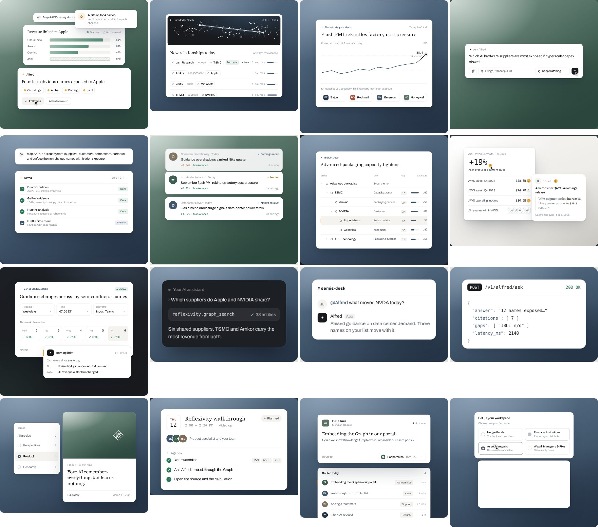

# polished-ui-motion

A portable package for producing animated, abstracted product-UI illustrations at the polish level of the Reflexivity build.

## What's inside

| Path | What it is |
|---|---|
| `PROMPT.md` | **Start here.** Copy-paste prompt for a new AI coding session; fill in 3 lines. |
| `STYLE.md` | The full spec: principles, tokens, type, 23-composition catalogue, motion grammar, hard rules, process, QA checklist. |
| `SKILL.md` | The same instructions as a Claude Code skill (see "Use as a skill"). |
| `kit/kit.tsx` | Components: `Canvas` (fixed design canvas, scale-capped, phone crop), `Field` (brand gradient stage), `useTimeline` (phase timeline, pauses off-screen, reduced motion), `useTyped`, `Cursor`, `Glyph`, `Ticker`, `Mono`, `Delta`, `CiteChip`, `Spark`, `Icon`, eases. |
| `kit/anchor.ts` | `useAnchor`, which measures elements in canvas coordinates so the cursor lands exactly. |
| `kit/kit.css` | Tokens, card elevation, type helpers, hatching, 4 brand fields, grain. Rebrand the lines marked BRAND. |
| `examples/` | 13 approved scenes (layered stack, deep graph, alert roll, document with rail, ranked table, segmented control, dashboard, memo + drawer, settings table, constellation, inbox routing, run checklist, selection + preview). |
| `lab/page.tsx` | Template for the private review page. |
| `tools/capture.js` | Screenshots every illustration on a page at chosen widths and moments; reports overflow and errors. |
| `tools/measure.js` | Prints canvas coordinates of text inside an illustration, for aiming the cursor. |
| `tools/contact_sheet.py` | Stitches screenshots into one review sheet. |
| `reference/` | Contact sheets of all 47 finished graphics. |

## Requirements
- React 18+, a Next.js App Router project, Tailwind CSS v4, plus `npm i motion clsx`.
  - The examples use `@/components/visual/kit` imports, so install the kit at `components/visual/`.
  - Outside Next.js it works in any React app; drop the `"use client"` lines if you don't need them.
- For the tools: Node with Playwright (`npm i -D playwright && npx playwright install chromium`) and Python 3 with Pillow (`pip install pillow`).

## Use it

### Option A: paste the prompt (any AI coding assistant)
1. Copy this folder into the new project root.
2. Open `PROMPT.md`, fill in Product, Brand and Slots, and paste it into the session.

### Option B: use it as a Claude Code skill
1. Copy this folder to `~/.claude/skills/polished-ui-motion/` (all projects) or `<project>/.claude/skills/polished-ui-motion/` (one project).
2. Ask for "product UI illustrations in the polished-ui-motion style". The skill loads `SKILL.md`, which points at everything else.

### Option C: by hand
1. Copy `kit/` into `components/visual/` and import `kit.css` globally.
2. Rebrand `kit.css`.
3. Start from the closest example in `examples/`, and follow `STYLE.md` §6 (motion) and §10 (QA).

## Rebranding in 5 minutes
In `kit/kit.css`:
- **Fields:** rebuild the four `.field-*` gradients from the new palette: a light bloom top-left, a deep tone bottom-right, and a base linear. Use two mid-tones, one light and one dark.
- **Colours:** set `--rx-signal` (tiny accent) and `--rx-up` / `--rx-down`.
- **Shadows:** tint the shadow rgb toward the brand's darkest hue.
- **Fonts:** point `--font-sans`, `--font-serif` and `--font-code` at the brand fonts.

The examples carry the source project's finance content; rewrite their copy and data for the new product, and keep their structure and timing.
